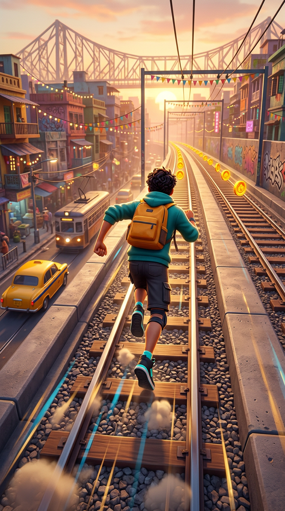

# Metro Dash 🏃‍♂️🌇

**A three-lane endless runner across a Kolkata sunset.** Sprint the metro rails,
jump the crossing gates, roll under the festival banners, dodge the coaches,
collect coins — and stay alive for one more metre.



> Rebooted from the old *Puppy Dash* prototype: the whole game was rebuilt from
> scratch for a real-3D-feel, Subway-Surfers-style run. Design documents live in
> [`docs/`](docs/README.md).

## Play

```bash
flutter pub get
flutter run -d chrome          # desktop browser
flutter run                    # Android device/emulator
```

On a development host, serve it for another device:

```bash
flutter run -d web-server --web-hostname 0.0.0.0 --web-port 8080
```

**Controls** — swipe left/right to change lane, swipe up to jump, swipe down to
roll. Keyboard: `←`/`→`, `↑`/`W`/`Space`, `↓`/`S`, `Esc` to pause.

**Goal** — one thing only: don't hit anything. Coins are worth 5, a clean
near-miss is worth 5 more, and the speed keeps climbing until the rails win.

## Status

| | |
|---|---|
| **Now** | Batch 0 — playable skeleton: hero, three lanes, obstacles, coins, HUD, title/game-over, local best score |
| **Next** | Batch 1 — world art (rails, city, props), full runner animation set, fairness-tested spawner (worker briefs in [`docs/ROADMAP_BATCHES.md`](docs/ROADMAP_BATCHES.md)) |
| **Docs** | [Game design](docs/GAME_DESIGN.md) · [Architecture](docs/TECH_ARCHITECTURE.md) · [Assets](docs/ASSET_PIPELINE.md) · [Art direction](docs/ART_DIRECTION.md) · [Roadmap](docs/ROADMAP_BATCHES.md) |

## Development

```bash
python3 tool/preflight.py                 # ~1 s safety gate, run before every commit
flutter test test/game_smoke_test.dart    # the one widget test that guards the loop
dart format lib test                      # CI checks formatting
flutter analyze                           # only for shared surfaces / risky diffs
```

Android package: `com.keshabstudios.metro_dash` · CI is manual
(*Actions → Flutter CI — Format, Analyze & Test*), a push starts nothing but
the web preview.

## Assets & credits

All art is **AI-generated for this repository** (pipeline and prompts:
[`docs/ASSET_PIPELINE.md`](docs/ASSET_PIPELINE.md)); raw renders are kept in
`docs/art/`. No third-party game art, no brand logos, no accounts, no
ads, no network calls at runtime. The city, the tram and the taxi are Kolkata's
— the hero is our own.
